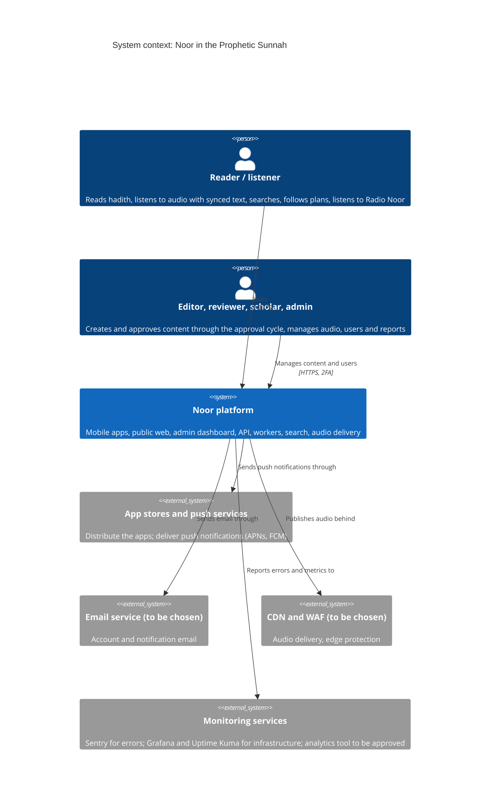

# C4 level 1: System context

Who uses Noor and which external systems it depends on. External services marked "to be chosen" are not yet selected; they are listed as roles.

Decisions: [ADR-015](../adr/ADR-015-hosting-and-infrastructure.md) (hosting, CDN and WAF), [ADR-001](../adr/ADR-001-backend-framework.md).
