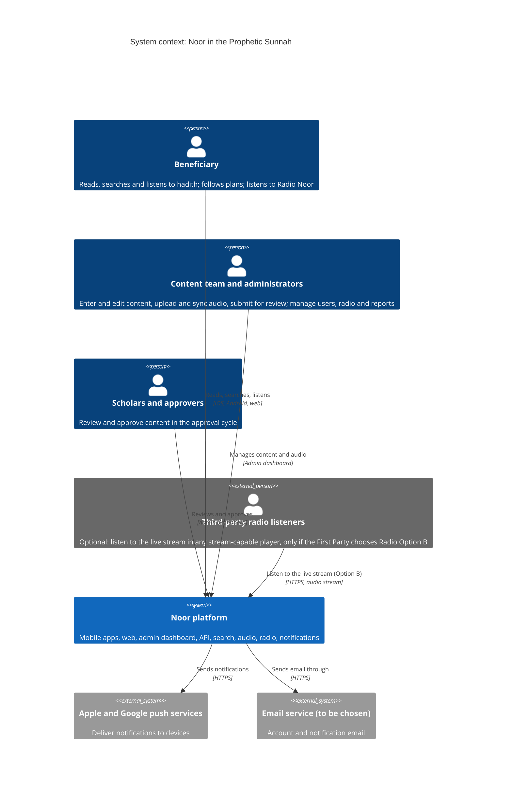

# C4 level 1: System context

Who uses Noor and which external systems it depends on. The edge, the audio CDN and the monitoring stack are part of the platform (we operate or select them), so the only external systems are the push services and an email service that is still to be chosen. Names match the Structurizr model.

Decisions: [ADR-015](../adr/ADR-015-hosting-and-infrastructure.md) (hosting), [ADR-025](../adr/ADR-025-edge-waf-and-cdn.md) (edge, WAF and CDN), [ADR-023](../adr/ADR-023-observability-and-analytics.md) (monitoring), [ADR-022](../adr/ADR-022-notifications.md) (push and email), [ADR-001](../adr/ADR-001-backend-framework.md).
