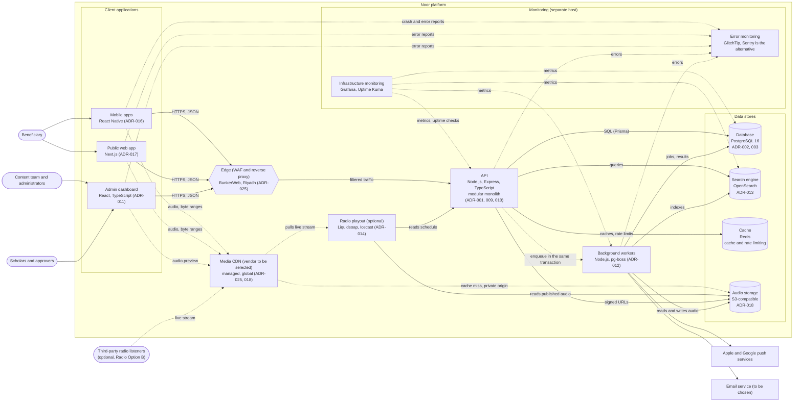

# C4 level 2: Containers

Applications, data stores and supporting services that make up Noor (drawn as a C4-style flowchart for readable layout; solid arrows are calls, dotted arrows are asynchronous or streaming paths). Names match the Structurizr model. Mobile and public web are covered by ADR-016 and ADR-017.

Notes:
- The API enqueues jobs in the same PostgreSQL transaction as the content change (ADR-012). Workers run as separate containers on a separate host (ADR-015).
- Web, API and login traffic goes through the self-hosted edge in Riyadh. Only audio and static media go through the managed CDN, so no third party terminates TLS for personal traffic (ADR-025).
- Radio Noor: the scheduled option is served by the API; an optional live stream adds a playout service reached through the CDN ([ADR-014](../adr/ADR-014-radio-noor.md)).
- Search is rebuilt from PostgreSQL if lost (ADR-004, ADR-013).
- Push and email are sent only by the workers in this view. The Notifications module in the API enqueues the jobs (ADR-022).
