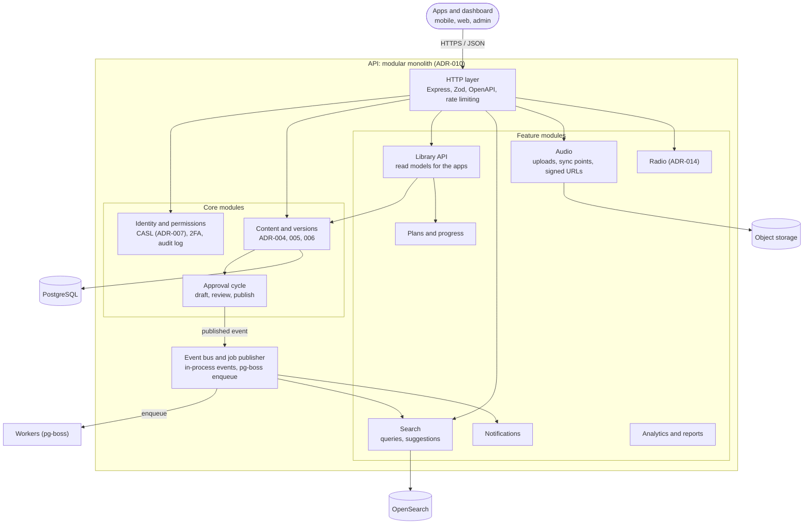

# C4 level 3: API components (modules)

The API is a modular monolith (ADR-010). Each module owns its tables and is used by others only through its public interface. Lint rules fail CI on forbidden imports. Module names are the "likely modules" from ADR-010 and may change as the design is detailed.

Rules shown here:
- Content and approval share transactions on purpose and are not split ([ADR-010](../adr/ADR-010-modular-monolith.md)).
- Extraction order if needed: audio, search indexing, radio.
- Not every dependency is drawn. The lint rules, not this diagram, are the source of truth.
