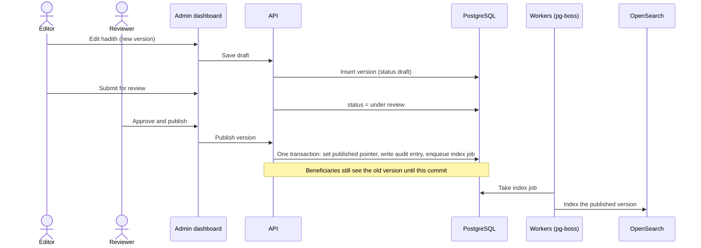
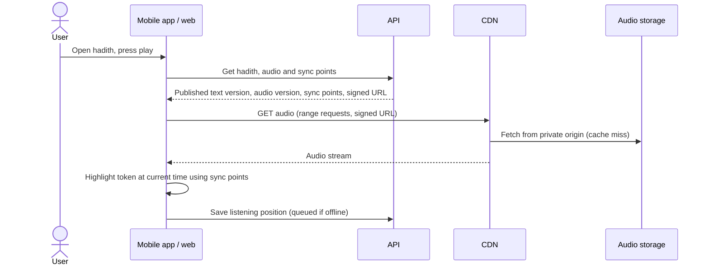

# Software Architecture Document: Noor in the Prophetic Sunnah

Status: draft for review by the First Party. Decisions are recorded in [docs/adr](adr/README.md). Diagrams are in [docs/c4](c4/README.md).

## 1. Introduction and goals
Scope from Annex Section 1: iOS and Android apps, a responsive web platform, an Arabic admin dashboard, backend and APIs, the scholarly content model, Arabic search, audio storage and processing, an audio sync tool, plans and review, notifications, Radio Noor, reports, infrastructure, backup and monitoring.

Capacity targets from Section 18: 10,000 registered users, 1,500 concurrent sessions at peak, 1,500+ hours of audio, 2 TB initial storage. Quality targets: API p95 under 500 ms, hadith screen under 1 s, audio start under 2 s on 4G, search under 1 s, availability 99.5% monthly.

Delivery: five months in five phases (Annex 23). Phase to decision mapping:

| Phase | Architecture decisions it relies on |
|---|---|
| 1 Foundation and first prototype | ADR-001, 002, 003, 009, 010, 011, 015, 016, 024 |
| 2 Content, admin, search | ADR-004, 005, 006, 007, 008, 013, 019 (manual tool), 020 |
| 3 Apps, audio, plans | ADR-016, 018, 019, 021, 022 |
| 4 Web, radio, reports | ADR-014, 017, 023 |
| 5 Test, launch, handover | ADR-015, 020, 024, performance and restore tests |

## 2. Constraints
Business and delivery rules that shape the design: the functional scope (Sections 1-16), capacity and quality targets (Section 18), the approval cycle and versioning rules (Sections 3, 15), security and privacy (Section 20), the 5-month schedule, the 12-month warranty, code in First Party repositories from day one, no use of project content to train AI or in unapproved external services (Section 28), and handover without dependence on the Executor (Sections 24, 26).

Technology is the Executor's selection, recorded in the decisions below. Where it differs from the technology list in Annex Section 17, it appears in the deviation register.

### Deviation register (Annex Section 17)
| Annex names | Our selection | Decision | First Party confirmation |
|---|---|---|---|
| Backend: Laravel | Node.js + Express, TypeScript | [ADR-001](adr/ADR-001-backend-framework.md), [ADR-009](adr/ADR-009-express-vs-nestjs.md) | To be recorded |
| Admin dashboard: Vue 3 | React + TypeScript | [ADR-011](adr/ADR-011-admin-dashboard-react.md) | To be recorded |
| Queues: Laravel Queues or equivalent | pg-boss on PostgreSQL (Redis for cache only) | [ADR-012](adr/ADR-012-background-jobs.md) | To be recorded |

### External services needing First Party approval (Annex 34)
| Service | Purpose | Decision |
|---|---|---|
| Hosting provider, CDN, WAF, object storage | Run the platform | [ADR-015](adr/ADR-015-hosting-and-infrastructure.md), [ADR-018](adr/ADR-018-audio-storage-and-delivery.md) |
| Firebase Cloud Messaging | Push notifications | [ADR-022](adr/ADR-022-notifications.md) |
| Email service (to be chosen) | Account and notification email | [ADR-022](adr/ADR-022-notifications.md) |
| Sentry (or equivalent) | Error monitoring | [ADR-023](adr/ADR-023-observability-and-analytics.md) |
| PostHog (or equivalent) | Product analytics | [ADR-023](adr/ADR-023-observability-and-analytics.md) |
| Git host and CI service | Repositories and pipelines | [ADR-024](adr/ADR-024-repositories-ci-and-testing.md) |

## 3. Context and scope (C4 level 1)
Noor serves three groups of people: beneficiaries (read, search and listen, on iOS, Android and the web), the content team (enter content, upload and sync audio, submit for review) and scholars and approvers (review and approve in the approval cycle). The content team and the scholars both work in the admin dashboard.

External systems: Apple and Google push services, an email service, a CDN and WAF, and monitoring and analytics services. Diagram: [C4 level 1](c4/01-context.md), and in the Structurizr model [workspace.dsl](c4/workspace.dsl).

Boundaries: the platform does not host the First Party's other products, does not connect to payment systems, and does not send content to external AI services (Section 28).

## 4. Solution strategy
| Area | Decision |
|---|---|
| Backend framework | [ADR-001](adr/ADR-001-backend-framework.md) |
| Database | [ADR-002](adr/ADR-002-database-postgresql.md) |
| Data access and migrations (Prisma) | [ADR-003](adr/ADR-003-data-access-and-migrations.md) |
| Express with hexagonal modules, not NestJS | [ADR-009](adr/ADR-009-express-vs-nestjs.md) |
| Modular monolith with extractable modules | [ADR-010](adr/ADR-010-modular-monolith.md) |
| Admin dashboard: React | [ADR-011](adr/ADR-011-admin-dashboard-react.md) |
| Background jobs: pg-boss on PostgreSQL | [ADR-012](adr/ADR-012-background-jobs.md) |
| Arabic search engine: OpenSearch | [ADR-013](adr/ADR-013-arabic-search.md) |
| Radio Noor: scheduled core, in-app baseline, optional live stream | [ADR-014](adr/ADR-014-radio-noor.md) |
| Hosting: Ubuntu hosts, Docker Compose first, Kubernetes later | [ADR-015](adr/ADR-015-hosting-and-infrastructure.md) |
| Mobile apps: React Native | [ADR-016](adr/ADR-016-mobile-apps.md) |
| Public web: Next.js | [ADR-017](adr/ADR-017-public-web.md) |
| Audio storage and delivery | [ADR-018](adr/ADR-018-audio-storage-and-delivery.md) |
| Audio processing and alignment | [ADR-019](adr/ADR-019-audio-pipeline-and-alignment.md) |
| Authentication and security | [ADR-020](adr/ADR-020-authentication-and-security.md) |
| Sync, offline and API versioning | [ADR-021](adr/ADR-021-sync-and-api-versioning.md) |
| Notifications | [ADR-022](adr/ADR-022-notifications.md) |
| Observability and analytics | [ADR-023](adr/ADR-023-observability-and-analytics.md) |
| Repositories, CI/CD and testing | [ADR-024](adr/ADR-024-repositories-ci-and-testing.md) |
| Content versioning | [ADR-004](adr/ADR-004-content-versioning.md) |
| Text anchors | [ADR-005](adr/ADR-005-text-anchors.md) |
| Classification trees | [ADR-006](adr/ADR-006-classification-trees.md) |
| Permissions | [ADR-007](adr/ADR-007-permission-model.md) |
| API contract | [ADR-008](adr/ADR-008-api-contract.md) |

The strategy in four lines: one modular monolith API with separate workers; PostgreSQL as the single source of truth, with search, cache and audio storage as rebuildable or replaceable satellites; TypeScript end to end with one OpenAPI contract; published content is the only content any client can see.

## 5. Building blocks (C4 levels 2 and 3)
Diagrams: [level 2](c4/02-containers.md), [level 3](c4/03-api-components.md), and the Structurizr model [workspace.dsl](c4/workspace.dsl).

### Containers (level 2)
| Container | Responsibility | Technology | Decision |
|---|---|---|---|
| Mobile apps | Library, search, audio with synced text, offline, plans, radio | React Native | ADR-016 |
| Public web app | Same for the web, SEO, direct links | Next.js | ADR-017 |
| Admin dashboard | Content, audio sync, approval, plans, radio, reports | React | ADR-011 |
| API | Business rules, permissions, REST and OpenAPI | Node.js, Express | ADR-001, 009, 010 |
| Background workers | Audio processing, indexing, notifications, exports, schedules | Node.js, pg-boss | ADR-012 |
| Database | Content, users, plans, versions, job queue | PostgreSQL 16 | ADR-002, 003 |
| Search engine | Arabic index | OpenSearch | ADR-013 |
| Cache | Cache and rate limiting only | Redis | ADR-012 |
| Audio storage | Originals and processed audio | S3-compatible | ADR-018 |
| Radio playout (optional) | Live stream if the First Party chooses Option B | Liquidsoap, Icecast | ADR-014 |

### API modules (level 3)
| Module | Responsibility |
|---|---|
| Identity and permissions | Accounts, roles, 2FA, audit log, authorization (ADR-007, 020) |
| Content | Books, chapters, hadith, narrations, narrators, explanations, trees (ADR-004, 005, 006) |
| Approval and versions | Draft, review, publish, restore; the published pointer (ADR-004) |
| Library API | Read models for apps and web |
| Search | Queries, suggestions, highlighting, indexing requests (ADR-013) |
| Audio | Audio records, segments, sync points, signed URLs (ADR-018, 019) |
| Plans and progress | Plans, reminders, bookmarks, progress, sync (ADR-021) |
| Notifications | Scheduled and event notifications (ADR-022) |
| Radio | Playlists, schedule, now-playing timeline (ADR-014) |
| Analytics and reports | Usage events, indicators, exports (ADR-023) |
| Event bus and job publisher | In-process events and transactional job enqueue (ADR-010, 012) |

Boundary rules (ADR-010): modules talk only through public interfaces, each module owns its tables, lint rules fail CI on forbidden imports. The extraction order if a module ever needs its own deployment is audio, search indexing, radio.

## 6. Runtime views

### 6.1 Publish a hadith through the approval cycle

Key rules: only the published pointer is read by public endpoints (ADR-004). The job is enqueued in the same transaction as the pointer change, so a published version is never left without its indexing job (ADR-012). A return with notes sends the version back to draft.

### 6.2 Play audio with synchronized text

Key rules: the signed URL is short-lived and only issued for published audio (ADR-018). Sync points reference text tokens of a specific text version (ADR-005, 019). Position saving is queued locally and synced later (ADR-021).

### 6.3 Radio Noor: what is playing now (Option A, in-app)
```mermaid
sequenceDiagram
  participant App as App / web
  participant API
  participant DB as PostgreSQL
  App->>API: GET radio now-playing
  API->>DB: Read schedule and published audio
  API-->>App: Current item, offset, next item, server time
  App->>App: Start playback at the offset; refresh at the item end
```
The schedule is computed from the playlist plus server time, so all listeners hear the same item. Unpublished items are skipped and the timeline is recalculated (ADR-014). With Option B, a playout service reads the same schedule and publishes a stream.

### 6.4 Search a hadith
App sends the query to the API. The Search module normalizes the query with the same analyzer chain as the index, queries OpenSearch, and returns hits with highlights mapped to the original vocalized text. The result links to content by ID (ADR-013).

## 7. Deployment view
Ubuntu LTS hosts running Docker Compose; separate application, worker, database and search hosts; object storage and CDN; backups in a separate location. Provider and region are set with the First Party. See [ADR-015](adr/ADR-015-hosting-and-infrastructure.md).

| Environment | Purpose | Notes |
|---|---|---|
| Development | Local work with Docker Compose | Same images as the others |
| Testing | Shared test, demos every two weeks, test builds for apps | Receives every merge |
| Production | Beneficiaries | Promotion of tested images, with manual approval |

## 8. Cross-cutting concepts
| Concern | Approach | Decision |
|---|---|---|
| Content visibility | Only the published pointer is readable by public endpoints, enforced in the data-access layer | ADR-004 |
| Permissions | CASL rules by function and by book, section or content; audit log for sensitive admin actions | ADR-007, 020 |
| Authentication | Sessions for web, tokens for mobile, mandatory 2FA for admins, Argon2id | ADR-020 |
| Arabic text | Stored unaltered with diacritics; tokens with stable IDs; Unicode normalization form agreed and applied consistently | ADR-005, 013 |
| Search normalization | One analyzer chain for indexing and querying; ta marbuta/ha rule pending scholar approval | ADR-013 |
| API contract | Zod schemas generate validation and OpenAPI; contract checked in CI; versioned by path | ADR-008, 021 |
| Background work | Transactional enqueue, retries, idempotent handlers, dedicated queue for timed notifications | ADR-012 |
| Offline and sync | Local-first user data, merge rules per record type, content version checks for downloads | ADR-021 |
| Observability | Error monitoring, metrics, uptime checks, structured logs, alerts | ADR-023 |
| Backup and restore | Daily database backup, WAL archive, separate location, quarterly restore test | ADR-015 |
| Privacy | Collect only what sync needs; no sensitive data in analytics; no content to external AI services | ADR-020, 023 |
| Configuration and secrets | Environment variables or a secrets manager; never in repositories or front-ends | ADR-020, 024 |
| Accessibility and RTL | VoiceOver, TalkBack, system font scaling, RTL in all clients, tested every release | ADR-016, 017 |
| Testing | Critical paths named in Annex 24 are automated; Arabic search cases are regression tests | ADR-024 |

## 9. Quality requirements
| Target (Annex 18) | How the design addresses it | How it is verified |
|---|---|---|
| 1,500 concurrent sessions | Stateless API replicas, CDN for audio, cache for read models, workers separate | Load test in Phase 5 on a production-like environment |
| API p95 under 500 ms | Read models, caching, indexes, async heavy work | Load test, with the typical-request mix agreed with the First Party |
| Hadith screen under 1 s | Published-only read model, cache, small payloads | Measured on device in the test environment |
| Audio start under 2 s on 4G | CDN, range requests, compressed streaming format | Measured on real devices and networks |
| Search under 1 s | OpenSearch with custom analyzers; real-corpus benchmark p99 under 120 ms at 50 concurrent requests, on one laptop | Re-run on the First Party's corpus and the production hosts |
| Availability 99.5% monthly | Scripted rebuild and restore, monitoring and alerts; second host behind a load balancer if needed | Uptime monitoring, restore test |
| App size around 50 MB | Tracked from the first build | Build reports |
| Last two major iOS and Android versions | Supported from the first build and tested on both | Device matrix |
| Security | OWASP Top 10, MASVS, PDPL controls | Pre-launch security scan and report |
| Backup and restore | Daily backup, separate location | Restore test at least every three months |

The benchmark figures in the ADRs come from a single laptop and are evidence for the choices, not acceptance results.

## 10. Risks and open points
| Risk or open point | Impact | Mitigation or next step |
|---|---|---|
| ADR-001 and the other deviations need the First Party's written approval | Contract risk (Annex 17) | Present the deviation register with the benchmark evidence; record the confirmation date and channel |
| Benchmark evidence comes from a single laptop; the search benchmark is incomplete | Sizing and performance claims may not hold | Production-like load tests before acceptance; re-run search benchmark on the real corpus |
| Search ranking and the ta marbuta/ha rule need scholar approval | Phase 2 acceptance depends on it | Schedule the scholar review early with the review pack ([ADR-013](adr/ADR-013-arabic-search.md)) |
| Hosting country, region and provider; data location under PDPL | May limit provider choice | First Party decision; list how Section 19 items are provided on the chosen provider |
| A single host per role gives no automatic failover | 99.5% depends on fast rebuild and restore | Demonstrate in restore and performance tests; add a second application host if needed |
| Vocalized Arabic rendering, background audio and offline downloads in React Native | Fail in the Phase 1 prototype would change the mobile decision | Prove in Phase 1; fall back to Flutter, which the annex names ([ADR-016](adr/ADR-016-mobile-apps.md)) |
| Word-level audio sync is not guaranteed | Annex 7 says "when possible" | Manual tool is the baseline; evaluate self-hosted alignment on real audio ([ADR-019](adr/ADR-019-audio-pipeline-and-alignment.md)) |
| Real audio and text samples arrive late | Pipeline and alignment tests slip | Ask the First Party for samples in Phase 1 |
| External services needing approval (Firebase, email, Sentry, analytics, CDN and WAF) | Delay or deviation from Annex 34 | Send one approval request with names, purpose, cost model and alternatives |
| Existing components of the Executor used in the project | Annex 27 requires advance disclosure and a licence | List them before development starts |
| Radio live stream (Option B) requested late | Schedule and cost impact | Agree the choice early ([ADR-014](adr/ADR-014-radio-noor.md)) |
| Corpus used in benchmarks has unverified redistribution rights | Cannot be shared or published | Kept local, not in the repository; ask the First Party for a real sample |
| Sign-in methods and privacy policy not yet defined | Account design and consent screens | Ask the First Party for the privacy policy and chosen sign-in methods ([ADR-020](adr/ADR-020-authentication-and-security.md)) |

## 11. Glossary
Hadith, riwaya (narration), rawi (narrator), gharib al-hadith (rare vocabulary), sharh (explanation), tashkeel (diacritics), wird (daily portion), isnad (chain of narrators), matn (text of the hadith), First Party (Dhurra Technology), Second Party or Executor (the supplier).
